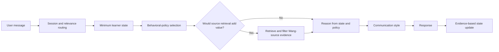

# Personalized AI Mentor

An evidence-grounded Codex skill for personalized study, project, and career supervision. It combines structured learner state, bounded behavioral-policy selection, and source retrieval that activates only when original evidence materially improves a decision.

The packaged evidence profile uses Alexandr Wang's public statements as a research case study. **This project is independent and is not affiliated with, endorsed by, sponsored by, or representative of Alexandr Wang, Scale AI, Meta, or any cited publisher.** It does not attempt to reproduce Wang's identity, voice, likeness, private beliefs, or distinctive wording.

## What this demonstrates

- Public-source corpus construction with provenance and evidence-quality boundaries
- Evidence extraction and synthesis into behavioral policies
- Session routing for planning, progress, blockers, reviews, learning, and career preparation
- Minimum-necessary state retrieval and evidence-based state updates
- Selective, cost-conscious RAG with source IDs and statement-type preservation
- A separate communication-style layer that cannot change substantive decisions
- Explicit safeguards against impersonation, fabricated evidence, unhealthy intensity, and persona overuse

## Evidence-profile case study

Alexandr Wang is used only as the subject of one documented public-source evidence profile. The architecture is the project: source provenance, evidence extraction, bounded policy translation, selective retrieval, and separation of substantive reasoning from presentation style. Wang's name identifies the subject of commentary and research; it is not the product name.

## Architecture



The behavioral model is the default representation. RAG is an evidence-on-demand supplement, not a requirement on every turn.

## Repository layout

```text
skill/
├── SKILL.md
├── references/
│   ├── sources/                  Public-source records AW_001–AW_012
│   ├── evidence/                 Evidence cards and synthesis
│   ├── persona-behavior-model.yaml
│   ├── policy-selection.yaml
│   ├── session-policies.yaml
│   ├── communication-style-model.yaml
│   ├── rag-config.yaml
│   └── rag-index.json            Generated local sparse index
├── scripts/
│   ├── build_rag_index.py
│   └── retrieve_rag.py
└── state/                        Fictional example state only
docs/
├── architecture.md
└── privacy.md
RIGHTS.md
THIRD_PARTY_NOTICES.md
```

## Try the retrieval layer

Requires Python 3 and no third-party packages.

```bash
cd skill
python3 scripts/build_rag_index.py
python3 scripts/retrieve_rag.py \
  --query "overhiring rapid expansion team quality flat headcount focus execution" \
  --max-results 4
```

An unrelated query should return no evidence:

```bash
python3 scripts/retrieve_rag.py \
  --query "marine biology coral reef salinity field sampling"
```

Run the automated retrieval checks from the repository root:

```bash
python3 -m unittest discover -s tests
```

## Evaluation

The commands above document and verify the portfolio artifact's behavior. Public availability does not grant permission to reuse, modify, redistribute, or incorporate the project into another product. The entry point is [skill/SKILL.md](skill/SKILL.md), the architecture is documented in [docs/architecture.md](docs/architecture.md), and the public/private separation is documented in [docs/privacy.md](docs/privacy.md).

## Source and identity boundaries

The repository stores concise source records, provenance, and analytical summaries—not a copied transcript archive. Direct statements, interviewer premises, reported behavior, and derived interpretations remain distinct. Public-source evidence is adapted to a study-supervision context only through explicit, bounded inference.

## Project status

Working text skill with a deterministic local RAG index and smoke-tested routing behavior. Voice, proactive scheduling, notifications, a standalone UI, dense embeddings, and external deployment are intentionally out of scope.

## Rights and reuse

This repository is **source-available for portfolio review, but it is not open source**. No open-source license is granted. Except for permissions supplied by applicable law or GitHub's Terms of Service, no permission is granted to use, copy, modify, redistribute, sublicense, or commercialize the repository's original materials.

See [RIGHTS.md](RIGHTS.md) for the repository owner's reservation of rights and [THIRD_PARTY_NOTICES.md](THIRD_PARTY_NOTICES.md) for the status of cited publications and names.
